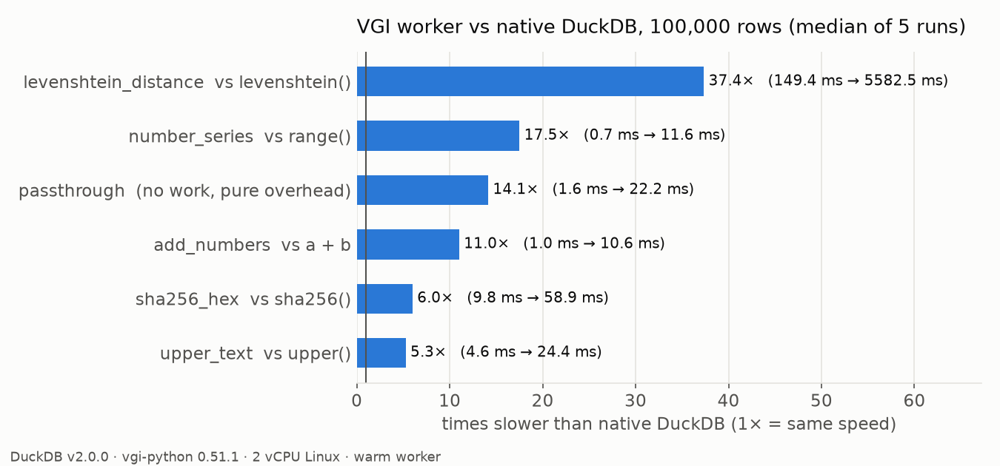
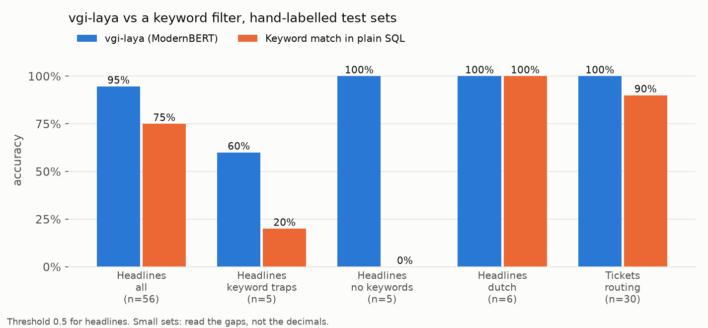

# VGI-tester

A [VGI](https://query.farm/vgi/) worker for DuckDB, built to test VGI itself:
how correct, how fast and how robust a VGI worker is compared with native
DuckDB, and how other VGI workers behave.

Part of my HBO-ICT graduation internship (Hogeschool van Amsterdam) at QXIP.

> **New to VGI?** Read [docs/what-is-vgi.md](docs/what-is-vgi.md) first.
> **Results:** [docs/test-report.md](docs/test-report.md).

## What's in it

Every function has a native DuckDB twin, so the results can be compared row by row.

| Function | Native twin | Kind |
|---|---|---|
| `passthrough(s)` | `s` | scalar, measures pure VGI overhead |
| `upper_text(s)` | `upper(s)` | scalar |
| `add_numbers(a, b)` | `a + b` | scalar |
| `sha256_hex(s)` | `sha256(s)` | scalar |
| `levenshtein_distance(a, b)` | `levenshtein(a, b)` | scalar |
| `number_series(n)` | `range(n)` | table function |
| `fail_with(x, msg)` | none | probe: raises an error |
| `kill_worker(x)` | none | probe: crashes the worker process |
| `slow_echo(s, ms)` | none | probe: adds latency |

## Quick start

Needs Python 3.13+ and [uv](https://docs.astral.sh/uv/). VGI currently needs
DuckDB v2.0.0 (stock `duckdb` or the [haybarn](https://github.com/Query-farm-haybarn/haybarn) build).

```sql
INSTALL vgi FROM community;
LOAD vgi;

ATTACH 'tester' (TYPE vgi, LOCATION 'uv run /path/to/VGI-tester/tester_worker.py');

SELECT tester.main.upper_text('duckdb');                 -- DUCKDB
SELECT tester.main.levenshtein_distance('ß', 's');       -- 1  (native levenshtein() says 2)
SELECT sum(n) FROM tester.main.number_series(1000);      -- 499500
```

## First results (13 Nov 2026)



- **Correct:** 12/12 correctness tests pass. Found that DuckDB's native
  `levenshtein()` counts UTF-8 bytes, not characters.
- **Robust:** a crashing worker does not crash DuckDB. The next query starts a new worker.
- **Overhead:** about 3.5 ms extra per query. Cheap functions get 4.5x to 57x
  slower; for heavy work (like ML inference) the overhead is noise.
- **Versions:** the same worker code runs on DuckDB 1.5 and 2.0, but only if
  the `vgi-python` SDK version matches the `vgi` extension's protocol.
- **vgi-laya:** 94.6% accuracy vs 75% for a keyword filter on 56 headlines,
  but the model ignores "NOT", and `score` / `confidence` don't match the docs.
  Details in the [report](docs/test-report.md#part-b-testing-vgi-laya).



## Run the tests yourself

```sh
uv sync
uv run pytest                                  # correctness: VGI vs native
uv run python bench/bench_native_vs_vgi.py     # speed, writes results/
uv run python bench/make_charts.py             # charts in docs/img/
```

Testing vgi-laya needs its own environment, see the end of the
[report](docs/test-report.md#how-to-reproduce).

## Layout

```
tester_worker.py        stdio entry point (the ATTACH LOCATION)
vgi_tester/
  worker.py             catalog + worker
  scalars.py            scalar functions with native twins
  tables.py             number_series table function
  probes.py             fail / crash / latency probes
tests/                  pytest correctness tests through real SQL
bench/                  speed benchmark, version matrix, vgi-laya tests, charts
results/                raw output of every run (csv / json)
docs/                   concept explanation and test report
```

## License

Apache-2.0 for the code in this repo. The VGI extension and the `vgi-python`
SDK it depends on are under the Query Farm Source-Available License 1.0.
