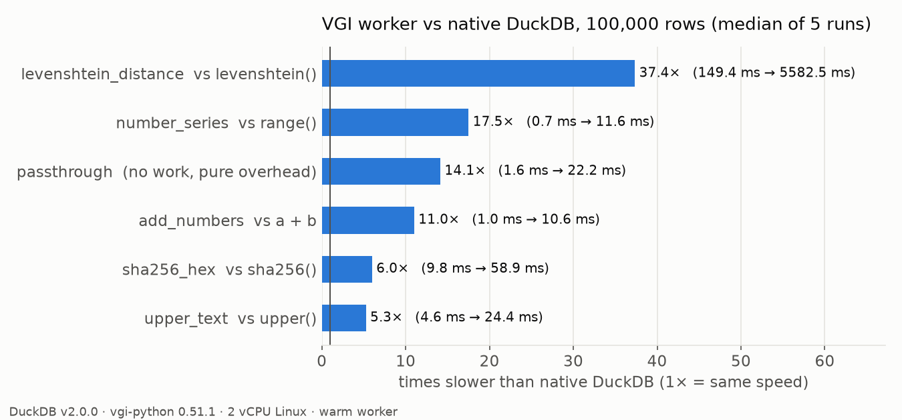
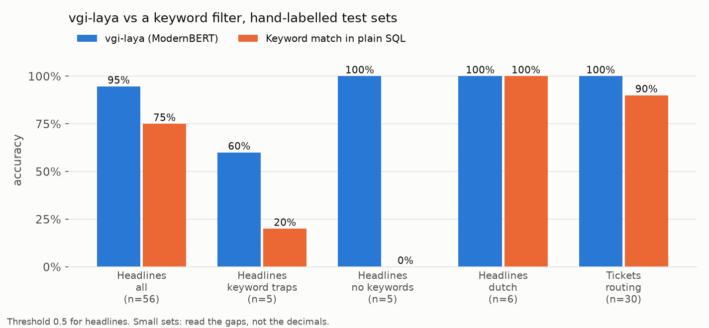

# Test report: first VGI worker and vgi-laya

Date: 13 November 2026. Author: Salim (HBO-ICT internship at QXIP).

This report has two parts:

- **Part A**: my own VGI worker (`vgi_tester`), compared with native DuckDB
  functions that do the same job.
- **Part B**: Lorenzo's [vgi-laya](https://github.com/lmangani/vgi-laya)
  worker (commit `46e97ee`), tested through SQL.

For the idea behind VGI, see [what-is-vgi.md](what-is-vgi.md). All raw numbers
are in [`results/`](../results). Every script is in [`bench/`](../bench) and
[`tests/`](../tests), so everything here can be re-run.

## Test setup

| | |
|---|---|
| Machine | Linux x86_64 VM, 2 vCPU, 7 GB RAM, no GPU |
| DuckDB | v2.0.0 (haybarn 2.0.0rc11 and stock `duckdb` 2.0.0) |
| `vgi` extension | `e75482339d` from the community repository |
| Worker SDK | `vgi-python` 0.51.1 (protocol 3.3), Python 3.13 |
| vgi-laya | commit `46e97ee`, `laya` 0.4.31, PyTorch 2.15 CPU build |
| Transport | stdio (DuckDB starts the worker as a subprocess) |

---

## Part A: my worker vs native DuckDB

### A1. What I built

Each VGI function has a native twin, so results can be compared row by row.

| VGI function | Native twin | What it measures |
|---|---|---|
| `passthrough(s)` | `s` | pure VGI overhead, no work |
| `upper_text(s)` | `upper(s)` | vectorised Arrow compute |
| `add_numbers(a, b)` | `a + b` | vectorised Arrow compute, two columns |
| `sha256_hex(s)` | `sha256(s)` | Python loop per row |
| `levenshtein_distance(a, b)` | `levenshtein(a, b)` | heavy pure-Python loop per row |
| `number_series(n)` (table) | `range(n)` | table function output |
| `fail_with`, `kill_worker`, `slow_echo` | none | error and crash behaviour |

### A2. Correctness

12 of 12 tests pass ([tests/test_correctness.py](../tests/test_correctness.py),
output in [results/correctness_pytest.txt](../results/correctness_pytest.txt)).
Inputs include NULL, empty string, German `ß`, Dutch `ij`, Turkish `İ`, Japanese,
emoji, tabs and newlines, and a 10,000 character string. In the speed runs
below, every result was also compared with native: 0 mismatching rows.

**Finding: DuckDB's own `levenshtein()` counts bytes, not characters.**
`levenshtein('ß', 's')` returns 2 in DuckDB v2.0.0, because `ß` is 2 bytes in
UTF-8. The answer in characters is 1. Same for `'é'` vs `'e'` (2) and an emoji
vs one letter (4). For ASCII text both agree. My worker counts characters. The
test suite pins this difference so we notice if DuckDB changes it. This is the
kind of thing a tester worker is for: it found a real behaviour difference on
day one.

(`upper()` did match: DuckDB and Arrow both turn `straße` into `STRAẞE`.
Plain Python would give `STRASSE`, so the choice of library matters.)

### A3. Errors and crashes

| What I did | What DuckDB did |
|---|---|
| Python `ValueError` inside the worker | SQL `Invalid Input Error: VGI Worker Exception: ValueError: ...` with traceback. Next query works. |
| Worker kills itself (`os._exit`) mid-query | SQL `IO Error: ... Unexpected transport EOF`. **DuckDB keeps running.** Next call starts a new worker (0.4 s). |
| `BIGINT` overflow in `add_numbers` | Error, like native. But the type differs: VGI gives `InvalidInputException`, native gives `OutOfRangeException`. Code that catches a specific error type would behave differently. |
| Wrong argument type (`upper_text(42)`) | `Binder Error` at planning time, same as native. No data sent. |
| Unknown function name | `Catalog Error ... Did you mean "upper_text"?`, same as native. |

### A4. Speed

Each number is the median of 5 runs after one warm-up run. Queries wrap the
function in `max()` so all rows get computed but only one value comes back.

**Start-up** (fresh Python process each time, 5 runs, median):

| Step | Time |
|---|---|
| `LOAD vgi` | 221 ms |
| `ATTACH` (starts the Python worker) | 409 ms |
| first function call | 20 ms |
| second call | 3.3 ms |

**Fixed cost per query** (worker already running, 1 row): native 0.21 ms,
VGI 3.69 ms. So VGI adds about 3.5 ms to every query that touches it.

**Throughput:**

| Function | Rows | Native | VGI | Slower by |
|---|---:|---:|---:|---:|
| passthrough | 1,000,000 | 4.7 ms | 75.0 ms | 15.9x |
| upper | 1,000,000 | 14.7 ms | 82.1 ms | 5.6x |
| add | 1,000,000 | 1.7 ms | 39.3 ms | 23.5x |
| sha256 | 1,000,000 | 46.8 ms | 297.9 ms | 6.4x |
| levenshtein | 100,000 | 149.5 ms | 5,582.5 ms | 37.4x |
| number_series vs range | 10,000,000 | 8.8 ms | 501.1 ms | 57.0x |

Full table for 1k, 10k, 100k and 1M rows: [results/bench_throughput.csv](../results/bench_throughput.csv).



What this means:

- **Vectorised work stays reasonable.** `upper` and `sha256` stay between
  4.5x and 6.4x slower at every size. The worker handles a whole Arrow batch at
  once, so the cost per row is small (0.08 µs per row for `upper` at 1M rows).
- **Very cheap work looks bad in ratio.** `a + b` costs DuckDB almost nothing,
  so even a small transport cost is a big multiple. In absolute terms it is
  still 39 ms for a million rows.
- **Python loops are the real problem, not VGI.** `levenshtein` is 37x slower
  because the worker does the work in a pure-Python loop (about 56 µs per row),
  not because of the transport. A worker in Rust, or one that calls a C library,
  should close a large part of that gap.
- **Table functions pay per batch.** `number_series` sends 2,048 rows per
  batch. Generating 10M rows this way is 57x slower than `range()`. Fine for
  real data sources (an API, a file format), silly for things DuckDB already
  does natively.

### A5. Does the same worker run on other DuckDB versions?

Same `tester_worker.py`, no code changes. Only the Python environment of the
worker changes. ([bench/version_matrix.py](../bench/version_matrix.py),
raw output in [results/version_matrix.jsonl](../results/version_matrix.jsonl))

| DuckDB | Worker on `vgi-python` 0.47.0 (protocol 2.2) | Worker on `vgi-python` 0.51.1 (protocol 3.3) |
|---|---|---|
| stock 1.4.4 | no `vgi` extension published (HTTP 404) | no `vgi` extension published (HTTP 404) |
| stock 1.5.2 | no `vgi` extension published (HTTP 404) | no `vgi` extension published (HTTP 404) |
| haybarn 1.5.6 | **works** | fails: extension speaks `vgi.v2`, worker hosts `vgi.v3` |
| stock 2.0.0 | fails: extension speaks `vgi.v3`, worker hosts `vgi.v2` | **works** |
| haybarn 2.0.0 | fails: protocol mismatch | **works** |

The good part: one source file ran on DuckDB 1.5 and 2.0 without edits. The
catch: you must pick the SDK version that matches the `vgi` extension of that
DuckDB build, and the `vgi` extension must exist for that DuckDB version at all.
More on this in [what-is-vgi.md](what-is-vgi.md#4-what-vgi-does-not-solve-from-our-tests).

---

## Part B: testing vgi-laya

vgi-laya gives DuckDB four functions backed by the Laya model (ModernBERT-large,
about 421M parameters, runs locally):

- `is_interesting(text, instructions)`: yes/no as a probability (scalar)
- `noul(text, instructions => ...)`: same, as a table function
- `choice(text, instructions => ..., criteria => MAP {...})`: pick one option
- `score(text, instructions => ..., criteria => [...])`: place on an ordered scale

### B1. Lorenzo's own tests

`tests/test_laya_engine.py`: 10 of 10 pass. The repo's end-to-end test runs the
worker with `uv run laya_worker.py`, which on Linux pulls the full CUDA build of
PyTorch. I ran the same SQL path myself with a CPU build instead (below).
`CLAUDE.md` mentions `tests/test_functions.py`, but that file is not in the repo.

### B2. How I tested

Three small test sets, labelled by hand, in [bench/laya_data/](../bench/laya_data):

- **56 headlines**: "is this about databases, SQL or data engineering?"
  40 normal ones, plus 5 keyword traps ("Stock index hits all-time high"),
  5 on-topic headlines without obvious keywords ("B-trees vs LSM-trees ..."),
  and 6 Dutch ones.
- **30 support tickets**: route to shipping, billing or support. 24 normal,
  3 implicit ("Courier never showed up"), 3 Dutch.
- **12 incidents**: severity from 0 (minor) to 3 (critical).

As the "native" comparison I used what you can do in plain DuckDB SQL: a
keyword filter with `regexp_matches`. Script: [bench/test_laya.py](../bench/test_laya.py).

These sets are small and I labelled them myself. Treat the numbers as a first
signal, not as a benchmark score.

### B3. Quality

| Task | vgi-laya | Keyword SQL |
|---|---|---|
| Headlines, accuracy (threshold 0.5) | **94.6%** (53/56) | 75.0% (42/56) |
| Headlines, F1 | **0.947** | 0.720 |
| Tickets, accuracy | **100%** (30/30) | 90.0% (27/30) |
| Incidents, rank correlation (Spearman) | **0.907** | n/a |



- Laya's 3 mistakes on headlines: two keyword traps ("Police add suspect's
  fingerprints to national database" 0.61, "Our family recipe database is just a
  shoebox of index cards" 0.74) and one miss ("dbt tips for cleaner data
  transformations" 0.35). So the model still leans on the word "database".
- The keyword filter missed all 5 no-keyword headlines and fell for 4 of 5 traps.
  That gap is the whole reason to use a model.
- Average probability: 0.72 for on-topic headlines, 0.10 for off-topic ones.
  A threshold of 0.35 would have scored 96.4% here (but tuning on 56 rows is not
  something to trust).

### B4. Consistency (the "does it hallucinate?" checks)

| Check | Result |
|---|---|
| Same input twice | identical output (max difference 0.0) |
| Reworded question ("Is this headline about storing, querying or processing data in a database system?") | same decision on 85.7% of headlines; recall drops to 0.75 |
| Shuffled order of `choice` options | same answer on 100% of tickets |
| Same `choice` options renamed to `a`, `b`, `c` | same answer on 93.3% (2 tickets flipped to "shipping") |
| **Negated question** ("Is this headline NOT about ...?") | **fails**: 24 of 56 headlines scored above 0.5 for both the question and its negation |

**Finding: the model mostly ignores "NOT".** If you ask "is this NOT about
databases?", it answers roughly as if you asked "is this about databases?".
Users should always phrase questions positively and flip the result in SQL
(`1 - p`). This should be in the README.

### B5. Bugs and doc issues found

1. **`score` is not 0 to 1.** The README says "Score ranges from 0.0 (first level)
   to 1.0 (last level)". Laya returns the expected level *index*: with 4 levels
   the range is 0 to 3. Our incidents scored between 0.64 and 2.15. With 2 levels
   the range happens to be 0 to 1, which is probably why it was not noticed.
   The README example `WHERE s.score > 0.5` would select all 12 of our incidents,
   including "Typo on the about page" (0.64).
   *Fix:* divide by `len(criteria) - 1` in `ask_score`, or fix the docs.
2. **`confidence` is not the probability of the chosen answer.** For `choice`,
   Laya returns `confidence` (how peaked the distribution is) and
   `answer_confidence` (the top probability). vgi-laya only exposes the first.
   On our tickets: average `confidence` 0.33, average `answer_confidence` 0.71,
   while every answer was correct. The README suggests
   `WHERE confidence > 0.8` to auto-route: that passes **0 of 30** tickets. Using
   `answer_confidence` it would pass 10 of 30.
   *Fix:* add an `answer_confidence` column, and explain both.
3. **`choice` accepts a single option.** The error text says "criteria must have
   at least two options", but the check is only `if not criteria`. A one-option
   map returns that option with confidence 1.0. `score` does check for 2+ levels.
4. **No batching.** `laya_engine` calls `agent.predict()` once per row. Laya also has
   `predict_batch()`. On the 56 headlines: per-row loop 13.8 s, `predict_batch`
   7.0 s, **1.97x faster with identical outputs** (max difference 0.0)
   ([results/laya_batch_check.json](../results/laya_batch_check.json)). On a GPU the
   gain is likely bigger. `CLAUDE.md` already lists this as a known sharp edge.
5. Small: `ask_noul` returns 0.5 when the model gives no answer. The repo's own
   rule says "errors throw". A silent 0.5 looks like a real "undecided" answer.
   I did not manage to trigger this path, so this is from reading the code.

### B6. Edge cases

| Input | Result | OK? |
|---|---|---|
| `NULL` text | `NULL` | yes |
| empty string / only spaces / only emoji | 0.13 / 0.12 / 0.09 | acceptable, but a NULL or error might be clearer |
| 20,000 characters | 0.82, works | partly: Laya cuts the input at 512 tokens (1,518 of 2,002 tokens dropped). Laya reports `truncated: true`, but vgi-laya does not pass that on to SQL |
| empty `instructions` | clear error | yes |
| `NULL` instructions | returns `NULL` | ok |
| a column as `instructions` | Binder Error: must be constant | yes, clear |
| `noul` without instructions | clear error | yes |
| `choice` without criteria / empty map | clear error | yes |
| `choice` with one option | accepted, confidence 1.0 | no (see B5.3) |
| `score` with 0 or 1 level | clear error | yes |
| `NULL` text in `choice` | row of NULLs | yes |

### B7. Speed

| | Time |
|---|---|
| `LOAD vgi` + `ATTACH` (fresh process) | about 1.4 to 1.9 s |
| first call (loads the model from disk cache) | about 2.8 to 3.3 s |
| warm, per row | about 245 ms (242 ms at 50 rows, 247 ms at 10 rows) |
| keyword filter in plain SQL, all 56 headlines | 1.4 ms |

On this 2-vCPU machine a row takes 5x to 8x longer than the README's
"30 to 50 ms per row", which is expected without a GPU. The cost per row is flat, so 1,000
rows take about 4 minutes. The VGI part (about 3.7 ms per query) is about 1.5% of
one row's model time, and far less for a real query. This is exactly the case
where VGI makes sense: the work dominates.

---

## Limitations of this round

- Test sets are small and labelled by one person (me).
- One machine, 2 vCPU, no GPU. No repeat on other hardware yet.
- Only the stdio transport. HTTP and Unix-socket workers not tested.
- Only a Python worker. A Rust or Go worker likely has lower overhead.
- No real native C++ extension was built for comparison. The "native" side is
  DuckDB's built-in functions, which is the best case for native.

## Next steps

1. Report the vgi-laya findings (B5) to Lorenzo, maybe as a PR with the
   `score` fix, `answer_confidence` column and `predict_batch`.
2. Turn the checks in Part B into reusable functions in this worker, so
   VGI-tester can test *any* worker: consistency (repeat, negation, option
   order), error handling, and speed.
3. Run the same benchmark with the HTTP transport and with a Rust worker.
4. Build one small native C++ extension with the same function, to compare
   build effort and maintenance, not just speed.

## How to reproduce

```sh
uv sync                                       # worker + dev deps
uv run pytest                                 # correctness (Part A)
uv run python bench/bench_native_vs_vgi.py    # speed (Part A)
uv run python bench/make_charts.py            # charts

# Part B needs a clone of vgi-laya with its own env (CPU torch is enough)
python bench/test_laya.py "/path/to/laya-env/bin/python /path/to/vgi-laya/laya_worker.py"
python bench/laya_batch_check.py              # run inside the laya env
```
